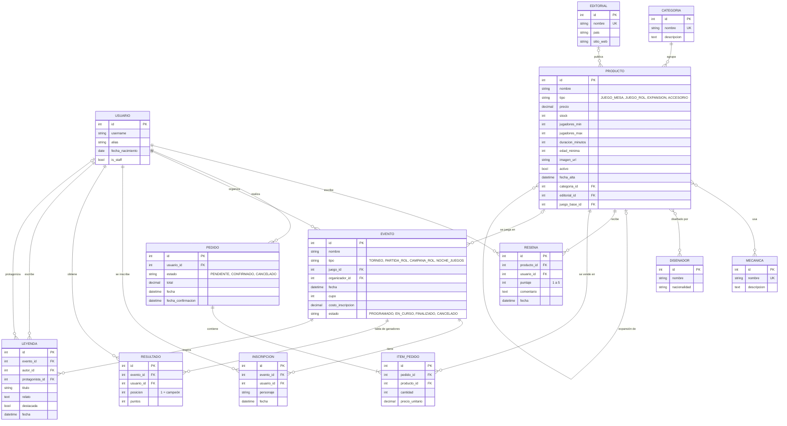

# Arcana — API

> *Donde cada tirada se convierte en leyenda.*

**Arcana** es una tienda de juegos de mesa y de rol que además es punto de encuentro de su comunidad. Vende juegos, manuales y accesorios, y organiza en su local torneos, partidas de rol y noches de juegos. Cada evento deja su **tabla de ganadores** y sus **leyendas**: crónicas de lo que pasó en la mesa, que forman el salón de la fama de la tienda.

Este repositorio contiene la **API REST** de Arcana, construida con Django y Django REST Framework, que consume el frontend [`boardgame-roleplay-hub-web`](https://github.com/ValenBelone7/boardgame-roleplay-hub-web).

> Evaluación Final Integradora 2026 — Ingeniería de Software (ITEC).

## Índice

- [Objetivo](#objetivo)
- [Stack](#stack)
- [Planificación de la base de datos](#planificación-de-la-base-de-datos)
- [Instalación con uv](#instalación-con-uv)
- [Instalación con Docker](#instalación-con-docker)
- [Variables de entorno](#variables-de-entorno)
- [Rutas principales](#rutas-principales)

## Objetivo

Exponer, a través de una API REST, todo lo que necesita la tienda y su comunidad:

- **Catálogo**: juegos de mesa, juegos de rol, expansiones y accesorios, con sus categorías, editoriales, diseñadores y mecánicas, y las reseñas de los jugadores.
- **Ventas**: pedidos de los usuarios con control de stock.
- **Eventos**: torneos y partidas de rol con inscripción y cupo, la tabla de ganadores de cada evento, un salón de la fama y las leyendas que escribe la comunidad.

## Stack

| Herramienta | Uso |
|---|---|
| Python 3.12 + [uv](https://docs.astral.sh/uv/) | Lenguaje y gestor de entorno y dependencias |
| Django 6.1 | Framework web, ORM y panel de administración |
| Django REST Framework | API REST, ViewSets, serializers, paginación, API navegable |
| djangorestframework-simplejwt | Autenticación por token (JWT) |
| drf-spectacular | Esquema OpenAPI, Swagger y Redoc |
| django-filter | Filtros en los endpoints |
| django-cors-headers | CORS para el frontend |
| python-dotenv | Variables de entorno desde `.env` |
| SQLite | Base de datos |
| Docker + Docker Compose | Contenedor del proyecto |

## Planificación de la base de datos

Antes de desarrollar se planificaron 13 modelos repartidos en 4 apps:

| App | Modelos |
|---|---|
| `usuarios` | Usuario |
| `catalogo` | Categoria, Editorial, Disenador, Mecanica, Producto, Resena |
| `ventas` | Pedido, ItemPedido |
| `eventos` | Evento, Inscripcion, Resultado, Leyenda |

### Diagrama entidad-relación



### Relaciones

| Relación | Tipo | Detalle |
|---|---|---|
| Categoria → Producto | 1 a N | Cada producto pertenece a una categoría (`PROTECT`: no se borra una categoría con productos) |
| Editorial → Producto | 1 a N | Opcional (los accesorios pueden no tener editorial) |
| Producto ↔ Mecanica | N a M | Un juego combina varias mecánicas |
| Producto ↔ Disenador | N a M | Un juego puede tener varios diseñadores |
| Producto → Producto | 1 a N (auto-relación) | `juego_base`: una expansión apunta a su juego base |
| Producto / Usuario → Resena | 1 a N | Una sola reseña por usuario y por producto |
| Usuario → Pedido → ItemPedido | 1 a N | El ítem guarda el `precio_unitario` del momento de la compra |
| Producto → Evento | 1 a N | Juego que se juega en el evento (opcional) |
| Usuario → Evento | 1 a N | Organizador del evento |
| Evento / Usuario → Inscripcion | 1 a N | Un usuario se inscribe una sola vez por evento; en rol puede indicar su personaje |
| Evento / Usuario → Resultado | 1 a N | Tabla de ganadores: un puesto por usuario y un usuario por puesto en cada evento |
| Evento / Usuario → Leyenda | 1 a N | Crónica con autor y, opcionalmente, un protagonista |

## Instalación con uv

Requisitos: [uv](https://docs.astral.sh/uv/getting-started/installation/) instalado.

```bash
git clone git@github.com:ValenBelone7/boardgame-roleplay-hub-django.git
cd boardgame-roleplay-hub-django

# Variables de entorno
cp .env.example .env          # completar SECRET_KEY

# Dependencias (crea el entorno virtual .venv)
uv sync

# Base de datos y superusuario
cd src
uv run manage.py migrate
uv run manage.py createsuperuser

# Servidor de desarrollo
uv run manage.py runserver
```

La API queda disponible en `http://127.0.0.1:8000/`.

## Instalación con Docker

Requisitos: Docker y Docker Compose.

```bash
cp .env.example .env          # completar SECRET_KEY
docker compose up --build
```

Las migraciones se aplican solas al iniciar el contenedor. En otra terminal:

```bash
docker compose exec web uv run --no-sync manage.py createsuperuser
```

La base SQLite se guarda en el volumen `arcana-data`, así que los datos se conservan entre `docker compose down` y `docker compose up`. Para empezar de cero: `docker compose down -v`.

## Variables de entorno

| Variable | Ejemplo | Descripción |
|---|---|---|
| `SECRET_KEY` | `"una-clave-larga"` | Clave secreta de Django |
| `DEBUG` | `True` | Modo debug |
| `ALLOWED_HOSTS` | `localhost,127.0.0.1,0.0.0.0` | Hosts permitidos, separados por coma |
| `CORS_ORIGINS` | `http://localhost:3000` | Orígenes del frontend habilitados por CORS, separados por coma |
| `SQLITE_PATH` | `/app/data/db.sqlite3` | Opcional. Ruta de la base; por defecto `src/db.sqlite3` (Docker la define sola) |

## Rutas principales

| Ruta | Descripción |
|---|---|
| `/` | Página de bienvenida |
| `/api/` | Raíz de la API navegable |
| `/api/token/` · `/api/token/refresh/` | Obtener y renovar el token JWT |
| `/api/schema/` | Esquema OpenAPI |
| `/api/schema/swagger/` | Documentación Swagger |
| `/api/schema/redoc/` | Documentación Redoc |
| `/admin/` | Panel de administración |
